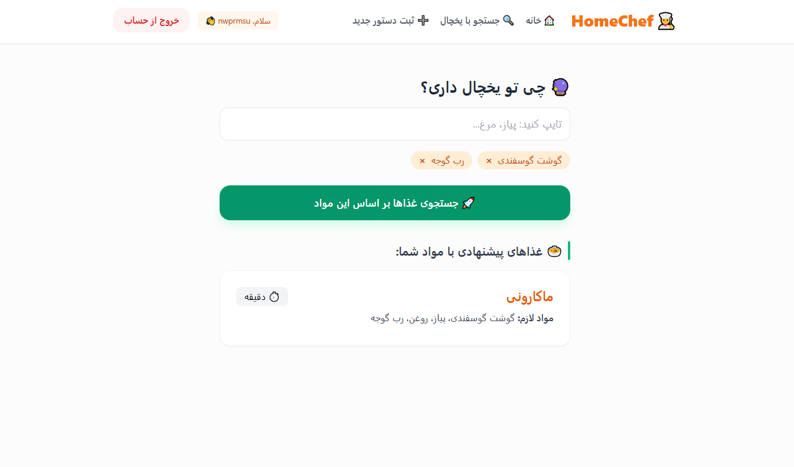
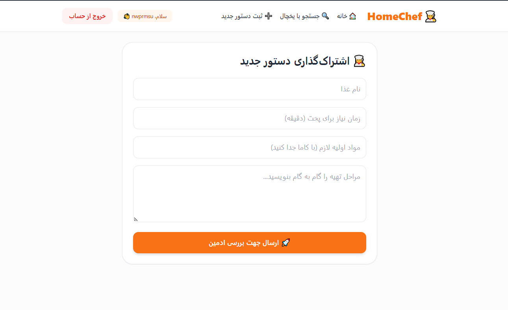
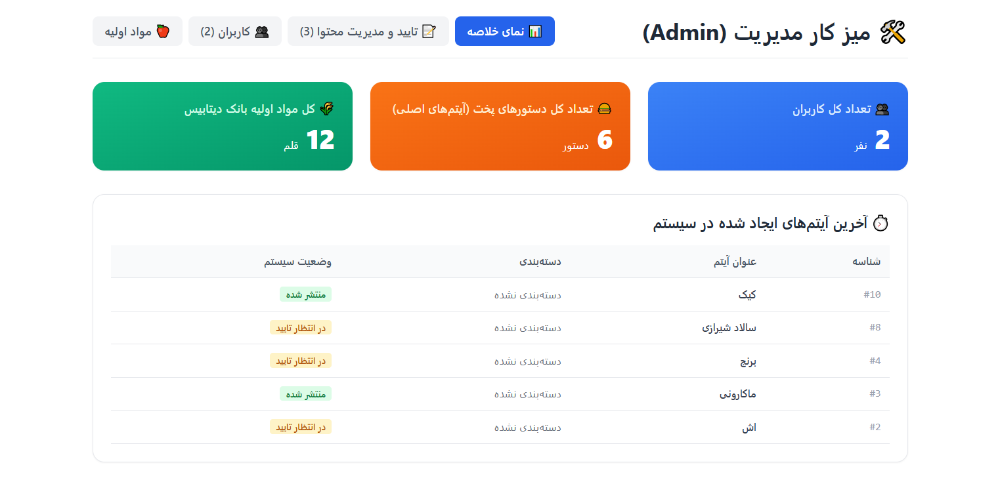
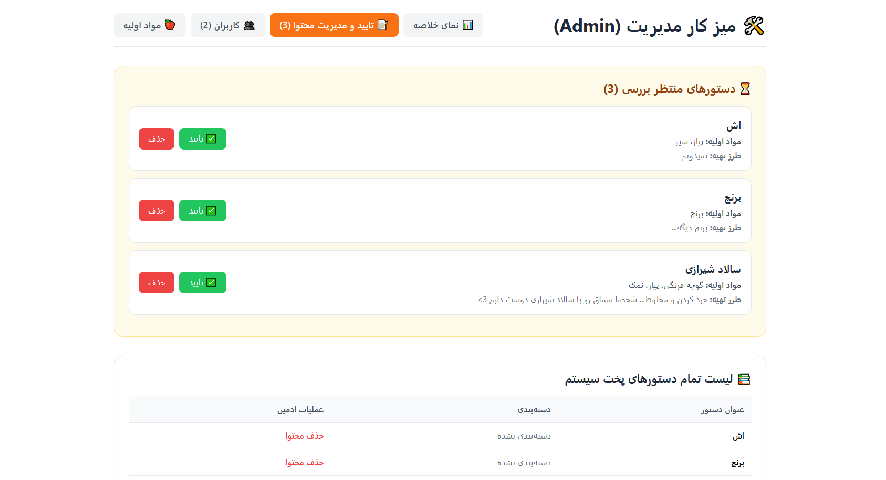

( Web development course - My picked final project )

---


# 🍳 HomeChef

Welcome to **HomeChef**, a full-stack, component-driven social network for recipe sharing and smart ingredient matching!

Built with a robust **FastAPI + PostgreSQL** backend and a highly optimized **React (Vite) + TailwindCSS** frontend.

---

# 🚀 Tech Stack & Architecture

## Backend

- **Core:** FastAPI (Python 3.11+) — high-performance, asynchronous, fully type-hinted
- **Database:** PostgreSQL managed through SQLAlchemy ORM
- **Authentication:** OAuth2 with JWT Bearer Tokens via specialized form-data flows

## Frontend (Clean Code Standards Applied)

- **Build Tool & Runtime:** Vite + React 18
- **Styling:** TailwindCSS (modern, responsive custom UI)
- **State Management:** Global `AuthContext` to eliminate deep prop drilling
- **Service Layer Isolation:** All API interactions are abstracted into `/services/recipeService.js`
- **Component Structure:** Modular, reusable architecture (`RecipeCard`, `Navbar`, etc.)

---

# 📂 Project Directory Structure

Following strict decoupled architecture principles:

```plaintext
src/
├── components/       # Reusable UI elements (Navbar, RecipeCard, etc.)
├── context/          # Global state wrappers (AuthContext for sessions & sign out)
├── pages/            # Independent pages (Home, CreateRecipe, etc.)
├── services/         # API layer wrapper (recipeService, interceptors)
├── App.jsx           # Application root router
└── main.jsx          # React mount entry point
```

---

# 🔮 Features & User Experience

Below are the core user-facing experiences available before admin or authentication restrictions apply.

---

## 1. 🏠 خانه (Home Page)

The social hub of ChefHome.

### Features

- Aggregated feed of approved community recipes
- Powered by the reusable `RecipeCard` component
- Smart navigation header with globally synchronized authentication state

---

## 2. 🔮 چی تو یخچال داری؟ (Search by Ingredients)

Don't know what to cook? Just enter the ingredients you have.

### How It Works

- Ingredients are searched directly from the database
- Debounced typeahead search for fast and responsive suggestions

### User Flow

1. Search and select ingredients
2. Click **🚀 جستجوی غذاها بر اساس این مواد**
3. The application:
   - Queries the service layer
   - Runs a client-side matching algorithm
   - Instantly displays compatible recipes

### Additional Support

Missing an ingredient?

Use the built-in support prompt to notify the **ادمین** immediately.

---

## 3. 👩‍🍳 اشتراک‌گذاری دستور جدید (Create Recipe Form)

Share your favorite recipes with the community.

### Smart Detection Guard

To maintain database parsing integrity, the form includes intelligent validation.

If users separate ingredients using:

- `-`
- `/`
- `|`

The application blocks submission and instructs them to use:

- Persian comma: `،`
- Standard comma: `,`

This guarantees consistent ingredient parsing and matching.

---

## 4. 📝 جزئیات دستور پخت (Recipe Details)

A focused recipe reading experience.

### Features

- Dynamic route handling via `/recipe/:id`
- Step-by-step cooking instructions
- Preparation and cooking timers
- Ingredient breakdown and measurements

---

# 🛠️ میز کار مدیریت (Admin Panel)


A restricted administrative dashboard providing complete content control.

## 📊 Analytics Dashboard

Track:

- Total users
- Approved recipes
- Active ingredients

## 🍎 Ingredient Management

Add new ingredients directly into the database with category support via the:

**💾 ثبت و ذخیره دیتابیس** pipeline

## 📝 Content Moderation

Review and approve user-submitted recipes before publication to the public feed.

---

# 🔑 Authentication & Global State

The application uses a centralized:

```jsx
<AuthProvider>
  <Router />
</AuthProvider>
```

architecture.

## Login Flow

- Users submit credentials through a `FormData` payload
- Authentication is handled by the `/token` endpoint

## Session Synchronization

Upon successful authentication:

- JWT tokens are stored securely
- User information is dispatched to `AuthContext`
- Dependent components (e.g., `Navbar`) update automatically

## خروج از حساب (Sign Out)

Signing out:

- Clears authentication variables
- Removes session storage safely
- Redirects users back to `/login`
- Prevents stale or empty-state rendering cycles

---

# 🛠️ Installation & Setup

## 1. Backend Setup

```bash
cd backend

python -m venv venv

# Linux / macOS
source venv/bin/activate

# Windows
venv\Scripts\activate

pip install -r requirements.txt

uvicorn main:app --reload --port 8000
```

---

## 2. Frontend Setup

```bash
cd frontend

npm install

npm run dev
```

---

# 🌐 Run the Application

Open your browser and navigate to the local Vite development server:

```text
http://localhost:5173
```

Start exploring recipes and happy cooking! 🍽️
